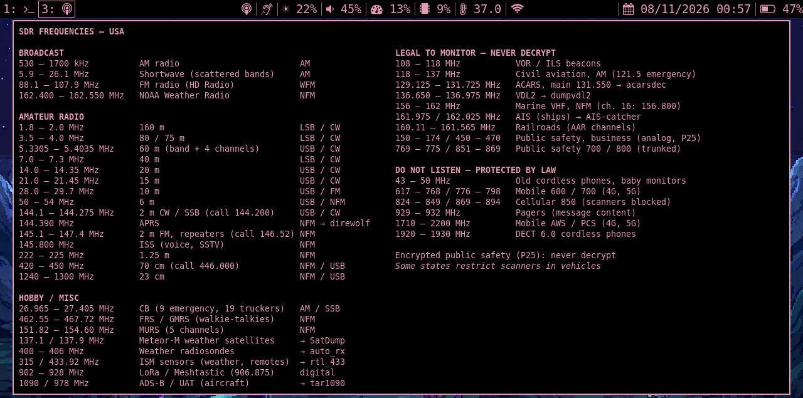
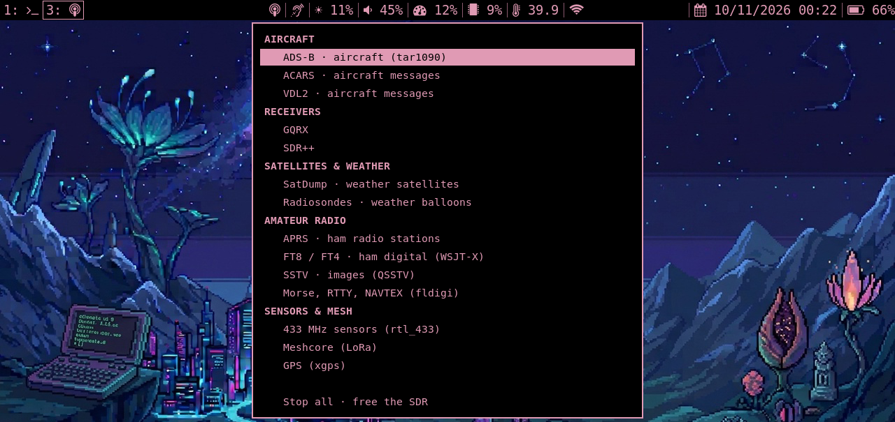
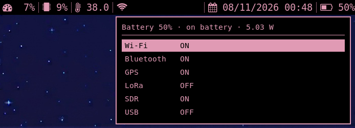

# uBonsole

An i3 setup for the **ClockworkPi uConsole** (CM4) built around software-defined radio: a pink-on-black
status bar, a one-click radio app launcher, an SDR frequency cheat sheet and a power menu for the
HackerGadgets **AIO v2** board (GPS, LoRa, SDR, USB rails).

The interface is available in **English, French, German and Spanish**, and the frequency cheat sheet
is tailored to where you use the device: **France, United Kingdom, Germany, Spain, USA, Canada** or
generic **Europe (ITU Region 1)**. Pick both at install time.

## Screenshots

**SDR frequency cheat sheet** (USA region) — click the antenna icon in the bar



**Radio app launcher** — click the ear icon



**Power menu** — click the battery



## Features

**Status bar** (i3bar + i3blocks), left to right:

| Block | Display | Click |
|---|---|---|
| Radio | antenna icon | SDR frequency cheat sheet for your region: broadcast, amateur radio, hobby bands, what you may and may not listen to, with the mode to use |
| Ear | running SDR app (`ADS-B`, `GQRX`…) | radio app launcher |
| Brightness | `☀ 22%` | left +1 / right −1 |
| Volume | speaker icon follows the level | left = mute, wheel = ±5 % |
| CPU / RAM | fixed-width percentages | |
| Temperature, Wi-Fi IP, date | | |
| Battery | icon follows the level, red below 15 %, warning at 10 % | power menu |

**Radio launcher** — ADS-B (readsb + tar1090), GQRX, SDR++, SatDump, radiosondes (auto_rx), ACARS,
VDL2, APRS (direwolf), 433 MHz sensors (rtl_433), Meshcore, GPS. Only one app can use the SDR dongle,
so the launcher stops the running one first. Text-mode decoders open in a terminal on workspace 3.
Missing apps are flagged `(not installed)`.

**Power menu** — shows battery level, state and power draw, and toggles Wi-Fi, Bluetooth and the
AIO v2 rails (GPS, LoRa, SDR, USB, via [aiov2_ctl](https://github.com/hackergadgets/aiov2_ctl)).

**Workspaces** — 1 terminal, 2 web, 3 radio (GQRX, SDR++, SatDump, decoders), 4 ADS-B
(tar1090 runs in its own Firefox instance so it always lands on workspace 4).

**Theming** — rofi menus and the `$mod+d` launcher share one theme (`scripts/rofi-pink.rasi`);
an optional Qt6 palette makes GQRX readable in the same colors.

## Install

```bash
git clone https://github.com/bt0r/uBonsole.git
cd uBonsole
./install.sh
```

The installer asks for the language and the region, offers to install missing packages, backs up your current
`~/.config/i3` to `~/.config/i3.backup-<date>`, copies the config and restarts i3. It can also apply
the Qt6 theme and install the SDR tools.

Non-interactive: `./install.sh --lang en --region us --qt-theme --yes`

Change them later in `~/.config/i3/ubonsole.conf`:
`UBONSOLE_LANG=en|fr|de|es` and `UBONSOLE_REGION=fr|uk|de|es|us|ca|eu`.
The scripts read this file on every click, so no restart is needed.

### Requirements

- uConsole with Debian / Raspberry Pi OS trixie, i3, i3blocks, rofi, FontAwesome and DejaVu fonts
- `st` terminal
- Optional: HackerGadgets AIO v2 board and `aiov2_ctl` (`~/aiov2_ctl/aiov2_ctl.py`)
- Optional SDR tools: `tools/install-sdr-tools.sh` (SDR++, SatDump, direwolf, acarsdec, dumpvdl2,
  radiosonde_auto_rx). It targets Debian trixie on arm64 and builds part of them from source, which
  takes a while on a CM4.
- ADS-B needs **readsb** and **tar1090**, which are not installed by these scripts.

### Update

```bash
cd uBonsole && git pull && ./install.sh
```

Each run makes a new backup. The installer copies files but never deletes any, so files from an
older config stay in `~/.config/i3` until you remove them.

### Uninstall

Put a backup back and restart i3 (`$mod+Shift+r`):

```bash
rm -rf ~/.config/i3
mv ~/.config/i3.backup-<date> ~/.config/i3
```

## Keyboard shortcuts

`$mod` is **Alt**.

| Keys | Action |
|---|---|
| `$mod+Return` | terminal (`st`) |
| `$mod+d` | app launcher |
| `$mod+1` … `$mod+0` | go to workspace 1–10 (`$mod+Shift+<n>` moves the window there) |
| `$mod+Home` / `$mod+End`, `$mod+PgUp` / `$mod+PgDn` | first / last, previous / next workspace |
| `$mod+j k l ;` or arrows | move focus (`$mod+Shift+…` moves the window) |
| `$mod+h` / `$mod+v` | split horizontally / vertically |
| `$mod+f` | fullscreen |
| `$mod+s` / `$mod+w` / `$mod+e` | stacked / tabbed / split layout |
| `$mod+Shift+space` | toggle floating |
| `$mod+Shift+p` / `$mod+Shift+m` | snap a floating window to the right / left half |
| `$mod+r` | resize mode (arrows, then Return or Escape) |
| `$mod+,` / `$mod+.` | brightness down / up |
| Volume keys | volume, mute |
| `Print` | screenshot to `~/Pictures` (`$mod+Print`: active window, `Shift+Print`: selection; add `Ctrl` to copy to the clipboard) |
| `$mod+Shift+q` | close window |
| `$mod+Shift+c` / `$mod+Shift+r` / `$mod+Shift+e` | reload config / restart i3 / quit |

## Using the radio apps

- **One app at a time**: the RTL-SDR dongle can only be opened by one program. The launcher stops
  the running app (and readsb) before starting another; "Stop all" frees the dongle.
- **sudo**: ADS-B starts and stops the `readsb` service with `sudo`. The ADS-B terminal asks for
  your password if needed. Other menus only call `sudo -n` (never prompt).
- **Text decoders** (ACARS, VDL2, APRS, 433 MHz, radiosondes) print a "listening on …" line, then
  one block per decoded message. A quiet terminal means nothing was received yet: check the antenna,
  go outside, or confirm activity on the waterfall in GQRX first.
- **Radiosondes**: auto_rx opens its web map on <http://localhost:5000>. Set your position in
  `~/src/radiosonde_auto_rx/auto_rx/station.cfg` first.
- **APRS** is receive-only (`config/direwolf/sdr.conf` uses the placeholder call sign `N0CALL`).

## Troubleshooting

- **A menu does not open**: rofi runs one window at a time. Close the open one with Escape, or click
  its icon again.
- **GQRX (or another Qt6 app) is white and hard to read**: run `./install.sh --qt-theme` to apply
  the dark Qt6 palette, then restart the app.
- **GPS on the AIO v2 shows nothing**: on some images the GPS UART (`/dev/ttyS0`) is also used by the
  serial console and a login prompt, so gpsd never gets the NMEA data (`journalctl` shows failed
  logins like `$GNGGA…`). Remove `console=serial0,115200` from `/boot/firmware/cmdline.txt`, disable
  `serial-getty@ttyS0`, point gpsd at `/dev/ttyS0` and reboot.
- **Other hardware**: the config assumes the uConsole: display `DSI-1` (rotated), battery
  `axp20x-battery`, Wi-Fi `wlan0`. Adjust `config/i3/config` and `i3blocks.conf` for other devices.

## Layout

```
config/i3/config              i3 config
config/i3/i3blocks.conf       status bar blocks
config/i3/scripts/            block scripts, menus, launcher, rofi theme
config/i3/lang/<lang>.sh      UI strings (en is the fallback)
config/i3/frequencies/        frequency cheat sheets, <region>/<lang>.txt, generated
config/i3/wallpapers/         wallpaper
config/qt6ct/colors/          Qt6 palette
config/direwolf/sdr.conf      direwolf receive-only config for APRS
tools/gen-frequencies.py      edit the frequency tables here, then run it
tools/install-sdr-tools.sh    SDR tools installer
```

## Adding a language

1. Copy `config/i3/lang/en.sh` to `config/i3/lang/<code>.sh` and translate the strings.
2. Add the language to `tr()` and every table in `tools/gen-frequencies.py`, then run it.
3. Add the code to `LANGS` / `LANG_NAMES` in `install.sh`.

## Adding a region

Add an entry to `REGIONS` and `TITLE` in `tools/gen-frequencies.py`, run it (it reports any line
that does not fit the screen), then add the code to `REGIONS` / `REGION_NAMES` in `install.sh`.

## Notes

- Ranges follow the ITU Region 1 / Region 2 band plans and national allocations (ARCEP, Ofcom,
  BNetzA, CNAF, FCC, ISED), checked in 2026. "Do not listen" ranges are indicative blocks, not an
  official list, and the law differs between countries: check your local regulations.
- Based on the community config [dzaczek/Uconsole-i3](https://github.com/dzaczek/Uconsole-i3)
  and the default i3 config.
