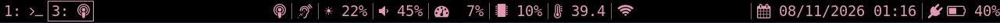
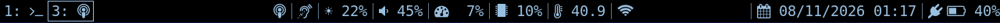
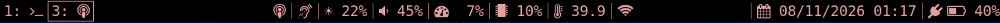
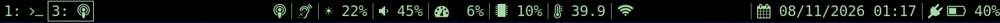
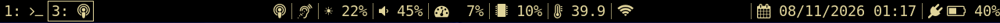
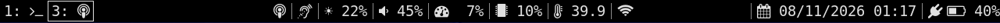

# uBonsole

An i3 desktop for the **ClockworkPi uConsole** (CM4) that turns it into a pocket SDR station: a
pastel-on-black status bar, a one-click launcher for 30 radio apps (aircraft, ships, satellites,
amateur radio digital modes, band scanner…), an SDR frequency cheat sheet and a power menu for the
HackerGadgets **AIO v2** board (GPS, LoRa, SDR, USB rails). Everything decodes locally and works
offline.

The interface is available in **English, French, German and Spanish**, and the frequency cheat sheet
is tailored to where you use the device: **France, United Kingdom, Germany, Spain, USA, Canada** or
generic **Europe (ITU Region 1)**. The accent color is yours to pick among six pastels: **pink**
(default), **blue**, **red**, **green**, **yellow** and **white**, or any custom `#RRGGBB`. Choose all
three at install time.

## Screenshots

**SDR frequency cheat sheet** (USA region) — click the antenna icon in the bar


**Radio app launcher** — click the ear icon


**Power menu** — click the battery


### Accent colors

The bar, window borders, menus, launcher and (optionally) the terminal follow the accent color picked
at install time (`./install.sh --color <name>`). Six pastels are available, and the installer also
takes any custom `#RRGGBB` (`--color '#A0C4FF'`): it warns when a color is too dark to read on black.

**Pink (default)**



**Blue**



**Red**



**Green**



**Yellow**



**White**



## Features

**Status bar** (i3bar + i3blocks), left to right:

| Block | Display | Click |
|---|---|---|
| Radio | antenna icon | SDR frequency cheat sheet for your region: broadcast, amateur radio, hobby bands, what you may and may not listen to, with the mode to use |
| Ear | running SDR app (`ADS-B`, `GQRX`…) | radio app launcher |
| Brightness | `☀ 22%` | left +1 / right −1 |
| Volume | speaker icon follows the level | left = mute, wheel = ±5 % |
| CPU / RAM | fixed-width percentages | |
| Temperature | | |
| Wi-Fi | IP when connected, icon alone when not connected, crossed-out icon when Wi-Fi is off | right = copy the IP |
| Date and time | in the region's format (`12/31/2026 11:59 PM` in the USA, `31/12/2026 23:59` in France…) | |
| Battery | icon follows the level, red below 15 %, warning at 10 % | power menu |

**Radio launcher** — apps grouped by use: aircraft & ships (ADS-B with readsb + tar1090, ACARS,
VDL2, ACARS Hub, airband voice with RTLSDR-Airband, AIS with AIS-catcher), receivers (GQRX, SDR++, DAB+ with
welle.io, band scanner, listen to the signal), satellites & weather (SatDump, Gpredict, radiosondes
with auto_rx), amateur radio (APRS with direwolf, including the ISS, FT8 / FT4 with WSJT-X, JS8Call,
SSTV with QSSTV, Morse / RTTY / NAVTEX with fldigi), sensors & mesh (433 MHz with rtl_433, Meshcore,
GPS). Only one app can use the SDR dongle, so the launcher stops the running one first. Text-mode decoders open in a terminal on workspace 3. Missing apps are flagged
`(not installed)`. Everything decodes locally: no internet connection is needed.

**Power menu** — shows battery level, state and power draw, and toggles Wi-Fi, Bluetooth and the
AIO v2 rails (GPS, LoRa, SDR, USB, via [aiov2_ctl](https://github.com/hackergadgets/aiov2_ctl)).

**Session menu** — `$mod+Shift+e` or the **SELECT** button opens a menu to log out or shut down. Both
ask for confirmation, with "No" preselected. SELECT is ignored while the focused window is fullscreen,
so games can still use it. (`Fn+Esc`, the padlock key, is handled by the keyboard firmware: it locks
the keyboard and sends nothing to the system.)

**Workspaces** — 1 terminal, 2 web, 3 radio (GQRX, SDR++, SatDump, decoders), 4 ADS-B
(tar1090 runs in its own Firefox instance so it always lands on workspace 4).

**Theming** — one accent color on black for the bar, the window borders, the rofi menus and the
`$mod+d` launcher (`scripts/rofi-theme.rasi`). Optionally the terminal (text and cursor, through X
resources) and a dark Qt6 palette that makes GQRX readable follow the same color.

## Install

```bash
git clone https://github.com/bt0r/uBonsole.git
cd uBonsole
./install.sh
```

The installer asks for the language, the region, the accent color and whether the terminal should
use the same theme (off by default, as it overrides the colors of `~/.Xresources`), offers to install missing packages, backs up
your current `~/.config/i3` to `~/.config/i3.backup-<date>`, copies the config, writes
`~/.config/i3/ubonsole.conf` and restarts i3. It detects the AIO v2 tool, the ADS-B service and
auto_rx, then lists which radio apps it found. It can also apply the Qt6 theme and install the SDR tools.

Non-interactive: `./install.sh --lang en --region us --color blue --terminal-colors --qt-theme --yes`

Options: `--lang`, `--region`, `--color <name|#RRGGBB>`, `--terminal-colors` / `--no-terminal-colors`,
`--qt-theme`, `--sdr-tools`, `--yes` (`./install.sh --help`).

### Dependencies

Required (the installer offers to install the missing ones with apt):

| For | Debian packages |
|---|---|
| Desktop and bar | `i3` `i3blocks` `rofi` `feh` `x11-xserver-utils` `fonts-font-awesome` `fonts-dejavu-core` |
| Bar blocks | `brightnessctl` `wireplumber` (volume) `network-manager` (Wi-Fi) `rfkill` (Bluetooth) |
| Screenshots | `maim` `xdotool` `xclip` |
| ADS-B map, auto_rx page | `firefox-esr` |
| Scripts | `python3` |
| Terminal | `st` (not in Debian under that name: the uConsole images ship it in `/usr/local/bin`; `stterm` + a symlink also works) |

Optional, per radio app. A missing app is shown as `(not installed)` in the launcher:

| App | Package / source | Installed by `tools/install-sdr-tools.sh` |
|---|---|---|
| GQRX | `gqrx-sdr` | yes |
| SDR++ | official `.deb` (SDRPlusPlus nightly) | yes |
| SatDump | `satdump` | yes |
| APRS | `direwolf` + `rtl-sdr` (`rtl_fm`) | yes |
| 433 MHz sensors | `rtl-433` | yes |
| ACARS / VDL2 | `acarsdec` / `dumpvdl2` (+ `libacars`), built from source | yes |
| ACARS Hub | Docker + image `ghcr.io/sdr-enthusiasts/docker-acarshub` (about 300 MB on disk) | the image, when Docker is installed |
| Airband voice | [RTLSDR-Airband](https://github.com/rtl-airband/RTLSDR-Airband) 7.0.0, built from source | yes |
| AIS (ships) | AIS-catcher, official `.deb` from [GitHub](https://github.com/jvde-github/AIS-catcher/releases) (0.70) | yes |
| DAB+ | `welle.io` | yes |
| Band scanner | `rtl-sdr` (`rtl_power`) + `python3-pil` + `feh` | yes |
| Satellite passes | `gpredict` | yes |
| Radiosondes | radiosonde_auto_rx, built from source in `~/src` | yes |
| ADS-B | `readsb` (or `dump1090-fa`) + `tar1090` | no, see their install scripts |
| Meshcore | `meshcore-console` ([meshcore-uconsole](https://github.com/cwill747/meshcore-uconsole)) | no |
| FT8 / FT4 | WSJT-X, official `.deb` from [GitHub](https://github.com/WSJTX/wsjtx/releases) (3.0.2) | yes |
| SSTV | `qsstv` | yes |
| Morse, RTTY, NAVTEX | `fldigi` | yes |
| JS8Call | `js8call` | yes |
| Audio modes (the four above) | `rtl-sdr` (`rtl_fm`) + `pipewire-bin` (`pw-loopback`, `pw-cat`, `pw-dump`), PipeWire audio | yes |
| GPS | `gpsd` (system setup, see "Offline use") + `gpsd-clients` (`gpspipe`) | `gpsd-clients` only |

`tools/install-sdr-tools.sh` targets Debian trixie on arm64 and builds part of the tools from
source, which takes a while on a CM4.

### HackerGadgets AIO v2 board (optional)

The power menu and the radio launcher switch the board's GPS, LoRa, SDR and USB rails through
[aiov2_ctl](https://github.com/hackergadgets/aiov2_ctl):

```bash
git clone https://github.com/hackergadgets/aiov2_ctl.git ~/aiov2_ctl
sudo python3 ~/aiov2_ctl/aiov2_ctl.py --install    # optional: installs the "aiov2_ctl" command
```

The installer finds either the `aiov2_ctl` command or `~/aiov2_ctl/aiov2_ctl.py`. Elsewhere, set
`AIOV2_CTL` in `ubonsole.conf`. Without the board, those toggles are simply hidden.

### Update

```bash
cd uBonsole && git pull && ./install.sh
```

Each run makes a new backup. The installer copies files but never deletes any, so files from an
older config stay in `~/.config/i3` until you remove them.

### Uninstall

Put a backup back and restart i3 (`$mod+Shift+r`):

```bash
rm -rf ~/.config/i3
mv ~/.config/i3.backup-<date> ~/.config/i3
```

## Configuration

`~/.config/i3/ubonsole.conf` is read on every click, so changes apply without restarting.
Reinstalling or updating keeps your values.

| Setting | Default | What it does |
|---|---|---|
| `UBONSOLE_LANG` | `en` | interface language: `en` `fr` `de` `es` |
| `UBONSOLE_REGION` | from the language | frequency sheet: `fr` `uk` `de` `es` `us` `ca` `eu` |
| `DATE_FORMAT` | from the region | date and time in the bar, `date` syntax (e.g. `'%a %d %b %H:%M'`). Empty: `31/12/2026 23:59` (fr, uk, es), `31.12.2026 23:59` (de), `12/31/2026 11:59 PM` (us), `2026-12-31 23:59` (ca, eu). The time zone stays the system's |
| `UBONSOLE_COLOR` | `pink` | accent color: `pink` `blue` `red` `green` `yellow` `white` or `#RRGGBB`. Applied by the installer: change it with `./install.sh --color <name>` |
| `UBONSOLE_TERMINAL_COLORS` | `no` | same theme in the terminal (text and cursor in the accent color), only if you accept it at install. Applied by the installer: `--terminal-colors` / `--no-terminal-colors` |
| `AIOV2_CTL` | detected | `aiov2_ctl` command or path to `aiov2_ctl.py`; empty = no AIO v2 board |
| `SDR_DEVICE` | `0` | default dongle (index or serial, `rtl_test -t` lists them): used directly with one dongle, preselected in the launcher with several |
| `SDR_GAIN` | `40` | tuner gain in dB for those decoders |
| `ADSB_SERVICE` | detected | systemd service of the ADS-B decoder (`readsb`, `dump1090-fa`…) |
| `TAR1090_URL` | `http://localhost/tar1090` | page opened for ADS-B |
| `AUTORX_DIR` | detected | radiosonde_auto_rx folder (the one with `auto_rx.py`) |
| `BATTERY` | detected | battery in `/sys/class/power_supply` |
| `WIFI_IFACE` | detected | Wi-Fi interface shown in the bar (`wlan0` on the uConsole) |

### Other hardware, antennas and dongles

- **Antennas**: the scripts never assume which connector an antenna is on. They only open the
  RTL-SDR, so plug the antenna that suits the band (the frequency sheet tells you which band you are
  on). A 1090 MHz antenna will hear little on 137 MHz satellites or HF, and vice versa.
- **External or several SDR dongles**: the radio launcher asks which dongle to use (see "Using the
  radio apps"); `SDR_DEVICE` sets the default. Give each dongle a unique serial if two share one
  (`rtl_eeprom -s <serial>` with only that dongle plugged in). GQRX, SDR++ and SatDump choose their
  device in their own settings, auto_rx in `station.cfg`.
- **No AIO v2 board**: leave `AIOV2_CTL` empty. Everything else works the same.
- **Not a uConsole**: the i3 config rotates the display `DSI-1`: adjust `config/i3/config`. The Wi-Fi
  interface and the battery are settings (`WIFI_IFACE`, `BATTERY`), detected at install.

## Keyboard shortcuts

`$mod` is **Alt**.

| Keys | Action |
|---|---|
| `$mod+Return` | terminal (`st`) |
| `$mod+d` | app launcher |
| `$mod+1` … `$mod+0` | go to workspace 1–10 (`$mod+Shift+<n>` moves the window there) |
| `$mod+Home` / `$mod+End`, `$mod+PgUp` / `$mod+PgDn` | first / last, previous / next workspace |
| `$mod+j k l ;` or arrows | move focus (`$mod+Shift+…` moves the window) |
| `$mod+h` / `$mod+v` | split horizontally / vertically |
| `$mod+f` | fullscreen |
| `$mod+s` / `$mod+w` / `$mod+e` | stacked / tabbed / split layout |
| `$mod+Shift+space` | toggle floating |
| `$mod+Shift+p` / `$mod+Shift+m` | snap a floating window to the right / left half |
| `$mod+r` | resize mode (arrows, then Return or Escape) |
| `$mod+,` / `$mod+.` | brightness down / up |
| Volume keys | volume, mute |
| `Print` | screenshot to `~/Pictures` (`$mod+Print`: active window, `Shift+Print`: selection; add `Ctrl` to copy to the clipboard) |
| `$mod+Shift+e` or SELECT | session menu: log out, shut down |
| `Fn+Esc` (padlock) | locks / unlocks the keyboard (keyboard firmware) |
| `$mod+Shift+q` | close window |
| `$mod+Shift+c` / `$mod+Shift+r` | reload config / restart i3 |

## Using the radio apps

- **One app per dongle**: a dongle can only be opened by one program. The launcher stops the running
  apps before starting another; "Stop all" frees everything. ADS-B keeps running when the new app uses
  another dongle.
- **Several dongles**: ADS-B, ACARS, VDL2, ACARS Hub, airband, AIS, APRS, 433 MHz, the band scanner and the
  audio modes ask which dongle to use when more than one is plugged in (`SDR_DEVICE` is preselected).
  For ADS-B, the choice is written to `/etc/default/readsb` (`--device <serial>`, with `sudo`). GQRX,
  SDR++, SatDump and auto_rx keep choosing their device in their own settings; welle.io takes the
  first dongle. On HF, the RTL-SDR Blog V4 uses its built-in
  upconverter (no direct sampling); its HF reception may need the RTL-SDR Blog driver instead of
  Debian's `librtlsdr`.
- **AIO v2 rails**: with the board, the launcher switches on the rail an app needs before starting it
  (SDR for the SDR apps, LoRa for Meshcore, GPS for GPS). It never switches a rail off: use the power
  menu for that.
- **ADS-B** starts the `ADSB_SERVICE` service (readsb by default) and opens tar1090 on workspace 4.
  It keeps running until "Stop all" or until you start another SDR app. Starting the service uses
  `sudo`: without password-less sudo, a terminal opens just to ask for the password. Other menus only
  call `sudo -n` (never prompt).
- **Text decoders** (ACARS, VDL2, AIS, APRS, 433 MHz, radiosondes) print a "listening on …" line, then
  one block per decoded message. A quiet terminal means nothing was received yet: check the antenna,
  go outside, or confirm activity on the waterfall in GQRX first.
- **Radiosondes**: auto_rx opens its web map on <http://localhost:5000>. Set your position in
  `~/src/radiosonde_auto_rx/auto_rx/station.cfg` first.
- **APRS** is receive-only (`config/direwolf/sdr.conf` uses the placeholder call sign `N0CALL`). It
  listens on the region's frequency (144.390 MHz in the USA and Canada, 144.800 MHz elsewhere) or on
  the ISS digipeater (145.825 MHz), heard when the station passes over (see Gpredict).
- **ACARS Hub** shows the ACARS or VDL2 messages in the browser (<http://localhost:8080>): search,
  statistics, alerts and, while ADS-B runs, a map of the aircraft that sent them. The entry asks for
  VDL2 or ACARS, starts the decoder in its terminal and the ACARS Hub container (Docker). The container
  is created on first use (time zone of the system, `TAR1090_URL` for the map) and keeps its database
  in `~/.local/share/acarshub` (7 days). Its ports are published on 127.0.0.1 only and it sends nothing
  out; "Stop all" stops it. The ACARS and VDL2 entries feed it too while it runs. Docker commands use
  the `docker` group or password-less `sudo`. To recreate the container after changing a setting:
  `docker rm acarshub`.
- **AIS** decodes ships on 161.975 / 162.025 MHz and shows them on a map at <http://localhost:8100>.
  It is started with `-X off`: AIS-catcher would otherwise share what it receives with aiscatcher.org.
- **Airband voice** (RTLSDR-Airband) scans a list of AM channels and plays the active one on the
  speakers. The first start asks for the frequencies of your local airfield (tower, approach,
  ATIS…; 121.500 MHz is the emergency frequency) and writes `~/.config/rtl_airband.conf`; edit that
  file to change them (the launcher only sets the dongle).
- **DAB+** (welle.io): run a station scan from its menu on first start.
- **Band scanner**: sweeps a band for 60 s with `rtl_power` (presets follow the region: FM, airband,
  2 m, 70 cm, PMR446 or FRS / GMRS, ISM; or any range), prints the strongest signals and opens a
  heatmap (frequency across, time down) saved in `~/Pictures`. Below 24 MHz it needs the RTL-SDR
  Blog V4 (`rtl_power` has no Q-branch direct sampling).
- **Gpredict** shows satellite passes (ISS, weather satellites…). Like SatDump, it needs a connection
  now and then to update the orbits (Edit → Update TLE).
- **GPS** opens a popup with the fix, satellites, position, Maidenhead locator, altitude, speed and
  GPS time (from gpsd); open it again to refresh.
- **Audio modes** (FT8 / FT4, JS8Call, SSTV, fldigi): each entry asks for a frequency, then `rtl_fm`
  demodulates it into a virtual audio cable "uBonsole SDR" (`scripts/sdr-audio`, PipeWire only),
  which is the default input while the mode runs. WSJT-X, JS8Call, QSSTV and fldigi record from it
  without any setting: the launcher writes their audio input before starting them, turns PSK Reporter
  and APRS spotting off (nothing is uploaded) and skips fldigi's first-run wizard. JS8Call asks for a
  call sign on its first start. Switching mode or "Stop all" closes the decoder,
  removes the cable and restores your default input. "Other frequency…" takes any frequency and
  demodulation.
- **Listen to the signal**: plays the audio mode's signal on the speakers or headphones too (select it
  again to stop). Handy to check that something is received before blaming the decoder.
- **HF** (below 24 MHz: FT8 on 20 / 40 m, SSTV on 14.230 MHz, NAVTEX, CW, RTTY) uses the R820T
  direct sampling mode (`rtl_fm -E direct2`). It needs a long wire antenna; 2 m and 6 m work with
  the usual antennas.
- **FT8 / FT4 need an accurate clock** (within about 1 s). WSJT-X has no rig control here: the band
  shown in its window is a label only, the SDR frequency is the one picked in the launcher.

## Offline use

Everything decodes locally. What needs a connection now and then:

- **Clock** for FT8 / FT4: NTP when online; offline, the GPS of the AIO v2 board through gpsd and
  chrony, plus the board's battery-backed RTC (PCF85063). This is system setup, not done by
  `install.sh`:
  1. Free the GPS serial port (see "GPS on the AIO v2 shows nothing" below).
  2. `/etc/default/gpsd`: `DEVICES="/dev/ttyS0"` and `GPSD_OPTIONS="-n -s 9600"` (the u-blox module
     talks at 9600 baud; gpsd's speed detection fails on this port).
  3. `/etc/chrony/conf.d/gps.conf`: `refclock SHM 0 refid GPS precision 1e-1 offset 0.0 delay 0.2`
     and `makestep 1 -1` (step the clock whenever the GPS gets a fix).
  4. `/boot/firmware/config.txt`: `dtoverlay=i2c-rtc,pcf85063a` for the RTC, then reboot.
  5. Power the GPS at boot: `sudo python3 ~/aiov2_ctl/aiov2_ctl.py --install` then
     `aiov2_ctl --boot-rail GPS on`.
- **SatDump** downloads satellite orbits (TLE) from CelesTrak when it starts and keeps them in
  `~/.config/satdump/satdump_tles.txt`. They stay usable for one to two weeks: start SatDump once
  with a connection (a phone hotspot is enough) before leaving.
- **Gpredict** updates its orbits the same way (Edit → Update TLE).
- **Maps** of tar1090, AIS-catcher and auto_rx load their tiles online: offline, aircraft, ships and balloons still show,
  on an empty background.

## Troubleshooting

- **The keyboard stopped responding**: `Fn+Esc` locks it (keyboard firmware); press it again.
- **SELECT does not open the session menu**: the listener (`scripts/gamepad-buttons`) reads the
  gamepad input device, so your user must be in the `input` group (`id` lists your groups). It does
  nothing while a fullscreen window has the focus.
- **A menu does not open**: rofi runs one window at a time. Close the open one with Escape, or click
  its icon again.
- **GQRX (or another Qt6 app) is white and hard to read**: run `./install.sh --qt-theme` to apply
  the dark Qt6 palette (Fusion style), then restart the app. It also caps the Qt font size at 10 pt:
  uConsole images set 20 pt, which the Fusion style applies and which overflows GQRX on the screen.
- **Changing the color by hand in `ubonsole.conf` does nothing**: the color is written into the
  installed files, so run `./install.sh --color <name>` instead.
- **The terminal keeps its old colors**: st reads X resources when it starts, so only terminals
  opened after an i3 restart (`$mod+Shift+r`) change. With terminal colors on, uBonsole loads
  `~/.config/i3/Xresources` after your `~/.Xresources`, so its background, text, cursor and 16 ANSI
  colors win; fonts and other settings of `~/.Xresources` stay yours. Turn it off with
  `./install.sh --no-terminal-colors`.
- **GPS on the AIO v2 shows nothing**: on some images the GPS UART (`/dev/ttyS0`) is also used by the
  serial console and a login prompt, so gpsd never gets the NMEA data (`journalctl` shows failed
  logins like `$GNGGA…`). Remove `console=serial0,115200` from `/boot/firmware/cmdline.txt`, mask
  `serial-getty@ttyS0`, point gpsd at `/dev/ttyS0` at 9600 baud and reboot (see "Offline use").
  Indoors, a first fix can take several minutes or never come: go near a window or outside.
- **FT8 / FT4 decode nothing**: check the clock first (`chronyc tracking`; in WSJT-X, the DT column of
  decoded stations should stay within ±1 s), then the antenna. On HF, direct sampling is weak with a
  short antenna.
- **WSJT-X shows "default (Not found)" as audio input**: start it from the radio launcher, which creates
  the virtual cable first and selects `ubonsole_sdr_in`.
- **A decoder says "usb_claim_interface error" or finds no device**: another app still holds the
  dongle (use "Stop all"), or `SDR_DEVICE` points to a dongle that is not plugged in.

## Layout

```
config/i3/config              i3 config
config/i3/i3blocks.conf       status bar blocks
config/i3/scripts/            block scripts, menus, launcher, rofi theme (common.sh: settings + helpers,
                              gamepad-buttons: SELECT button listener,
                              sdr-audio: virtual audio cable for the audio decoders,
                              band-scan: band scanner, gps-info: GPS popup)
config/i3/lang/<lang>.sh      UI strings (en is the fallback)
config/i3/frequencies/        frequency cheat sheets, <region>/<lang>.txt, generated
config/i3/wallpapers/         wallpaper
config/qt6ct/colors/          Qt6 palette
config/xresources/            terminal colors (X resources), installed as ~/.config/i3/Xresources
config/direwolf/sdr.conf      direwolf receive-only config for APRS
tools/gen-frequencies.py      edit the frequency tables here, then run it
tools/install-sdr-tools.sh    SDR tools installer
tools/recolor.py              accent colors: swaps the reference pink in the installed files, checks contrast
```

## Adding a language

1. Copy `config/i3/lang/en.sh` to `config/i3/lang/<code>.sh` and translate the strings.
2. Add the language to `tr()` and every table in `tools/gen-frequencies.py`, then run it.
3. Add the code to `LANGS` / `LANG_NAMES` in `install.sh`.

## Adding a region

Add an entry to `REGIONS` and `TITLE` in `tools/gen-frequencies.py`, run it (it reports any line
that does not fit the screen), add the code to `REGIONS` / `REGION_NAMES` in `install.sh`, and its
date format to the `DATE_FORMAT` defaults in `config/i3/scripts/common.sh`.

## Adding a color

Add the pastel to `ACCENTS` in `tools/recolor.py` (the other shades are derived from it), then to
`COLORS` in `install.sh`. Keep it readable on black.

## Notes

- Ranges follow the ITU Region 1 / Region 2 band plans and national allocations (ARCEP, Ofcom,
  BNetzA, CNAF, FCC, ISED), checked in 2026. "Do not listen" ranges are indicative blocks, not an
  official list, and the law differs between countries: check your local regulations.
- Based on the community config [dzaczek/Uconsole-i3](https://github.com/dzaczek/Uconsole-i3)
  and the default i3 config.

## Contributing

Repository rules (Karma commit messages, translations, settings, keeping this README in sync, how to
test the installer) are in [CLAUDE.md](CLAUDE.md).

## License

[MIT](LICENSE)
